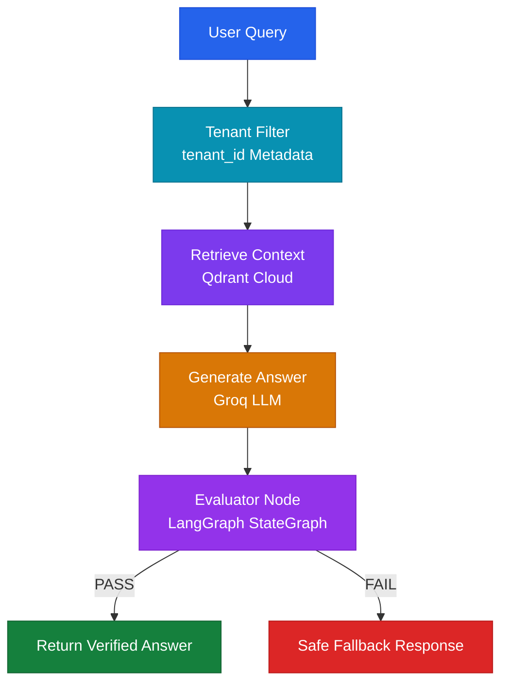

<div align="center">

# Enterprise Multi-Tenant Compliance AI Agent

### An Agentic RAG System for Secure, Tenant-Isolated Enterprise Compliance Intelligence

[](https://www.python.org/)
[](https://fastapi.tiangolo.com/)
[](https://www.langchain.com/langgraph)
[](https://www.docker.com/)
[](https://render.com/)

[](https://compliance-policy-ai-agent.onrender.com/docs)

**[Explore Live API Documentation](https://compliance-policy-ai-agent.onrender.com/docs)**

</div>

---

## Overview

The **Enterprise Multi-Tenant Compliance AI Agent** is an agentic Retrieval-Augmented Generation (RAG) application designed to answer enterprise compliance and policy-related questions while maintaining tenant-level data isolation.

Built using **FastAPI, LangGraph, Groq, Cohere, and Qdrant Cloud**, the application implements an intelligent retrieval and response-generation pipeline with an additional self-reflective evaluation mechanism to reduce hallucinations.

Unlike a conventional RAG implementation that directly returns LLM-generated responses, this system incorporates an evaluation node into its LangGraph StateGraph workflow. The generated answer is cross-verified against retrieved document context before being returned to the user.

The architecture also prioritizes cloud resource efficiency by using Cohere's hosted embedding API instead of heavyweight local embedding models, reducing container dependencies and memory requirements.

### Key Highlights

- **Multi-Tenant Data Isolation:** Enforces tenant-specific document retrieval through `tenant_id` metadata filtering in Qdrant Cloud.
- **Agentic RAG Architecture:** Orchestrates retrieval, generation, and evaluation using LangGraph StateGraph.
- **Self-Reflective Evaluation:** Implements an evaluation node that checks generated answers against retrieved context.
- **Hallucination Guardrail:** Rejects unsupported answers and returns a safe fallback response when evaluation fails.
- **Context-Grounded Responses:** Uses retrieved enterprise policy documents as the knowledge source for answer generation.
- **Cloud Resource Optimization:** Uses Cohere API-based embeddings to avoid heavyweight local PyTorch dependencies.
- **Lightweight Deployment:** Designed to operate within a 512 MB RAM deployment constraint.
- **Production-Oriented API:** Exposes application functionality through FastAPI with interactive Swagger documentation.
- **Containerized Deployment:** Uses Docker and Render for cloud deployment.

---

## Live Application

The application is deployed on Render and provides interactive API documentation through FastAPI.

| Resource | Link | Description |
|---|---|---|
| Live Application | [Open Live API](https://compliance-policy-ai-agent.onrender.com/) | Hosted application endpoint |
| Swagger Documentation | [Explore Swagger UI](https://compliance-policy-ai-agent.onrender.com/docs) | Interactive API documentation and endpoint testing |
| OpenAPI Schema | [View OpenAPI JSON](https://compliance-policy-ai-agent.onrender.com/openapi.json) | Machine-readable API specification |

**Note:** The application runs on Render's free tier. Initial requests may experience cold-start latency after periods of inactivity.

---

## Architecture Flow

The application follows an agentic RAG architecture with tenant-aware retrieval and an evaluation-based response validation mechanism.



### Architecture Components

| Component | Responsibility |
|---|---|
| User Query | Accepts enterprise compliance-related questions. |
| Tenant Filter | Restricts document retrieval using the requested `tenant_id`. |
| Retrieve Context | Searches Qdrant Cloud for relevant tenant-specific policy documents. |
| Generate Answer | Uses Groq-hosted LLM to generate a context-aware response. |
| Evaluator Node | Checks whether the generated response is supported by retrieved context. |
| PASS | Returns the verified, context-grounded answer. |
| FAIL | Prevents unsupported responses from being returned and provides a safe fallback. |

### Self-Reflective Evaluation Mechanism

A major design consideration is preventing the LLM from presenting unsupported information as verified compliance guidance.

The LangGraph evaluation node independently examines the generated response against the retrieved context.

The evaluation process follows two possible outcomes:

| Evaluation Result | System Behavior |
|---|---|
| PASS | Return the generated answer. |
| FAIL | Return a predefined safe fallback response. |

This evaluation mechanism introduces an additional validation layer between answer generation and response delivery.

---

## Tech Stack

| Category | Technology | Purpose |
|---|---|---|
| Programming Language | Python 3.11+ | Core application development |
| Backend Framework | FastAPI | REST API development |
| Application Server | Uvicorn | ASGI server |
| Agentic Engine | LangGraph | Agent workflow orchestration |
| Workflow Architecture | StateGraph | Structured execution and evaluation |
| LLM Provider | Groq | Hosted LLM inference |
| Language Model | `openai/gpt-oss-120b` | Context-aware answer generation |
| Vector Database | Qdrant Cloud | Vector storage and similarity search |
| Embedding Provider | Cohere | API-based text embeddings |
| Embedding Model | `embed-english-light-v3.0` | English text vector generation |
| Containerization | Docker | Application packaging |
| Cloud Deployment | Render | Cloud hosting (Free Tier) |
| API Documentation | Swagger UI / OpenAPI | API exploration and testing |

---

## Key Technical Decisions

### 1. Tenant-Level Data Isolation

The application uses Qdrant metadata filtering to restrict retrieval to documents associated with the requested tenant.

Each indexed document contains tenant-specific metadata.

Example metadata structure:

```json
{
  "tenant_id": "tenant_001",
  "source": "compliance_policy.pdf"
}
```

A tenant-specific filter ensures that vector retrieval is scoped to the relevant tenant.

Conceptual Qdrant filter:

```python
from qdrant_client.models import (
    Filter,
    FieldCondition,
    MatchValue
)

tenant_filter = Filter(
    must=[
        FieldCondition(
            key="tenant_id",
            match=MatchValue(value=tenant_id)
        )
    ]
)
```

**Engineering Benefits:**

- Tenant-specific document retrieval.
- Reduced risk of cross-tenant information exposure.
- Metadata-driven isolation.
- Scalable multi-customer architecture.

**Security consideration:** Tenant filtering must be combined with authenticated tenant identity and server-side authorization. A client-supplied tenant ID should never be trusted without validation.

### 2. Hallucination Guardrail

The system introduces a LangGraph evaluation node to validate generated answers against retrieved document context.

The evaluation process checks whether the generated response is supported by the available evidence.

If the answer fails evaluation, the system returns a safe fallback instead of presenting unsupported information as factual compliance guidance.

**Why this matters:**

In enterprise compliance applications, an unsupported answer can lead to incorrect policy interpretation and potentially harmful business decisions.

The evaluation stage provides an additional reliability mechanism beyond conventional retrieval and generation.

### 3. Cloud Resource Optimization

Deploying local embedding models can introduce significant memory overhead and heavyweight dependencies.

This implementation uses Cohere's hosted embedding API with:

`embed-english-light-v3.0`

| Conventional Local Embedding | Project Implementation |
|---|---|
| Local embedding model inference | Cohere API |
| Potential heavyweight PyTorch dependencies | No local PyTorch embedding runtime |
| Higher container resource requirements | Reduced embedding-related memory footprint |
| Local model loading | Hosted embedding generation |
| Larger deployment footprint | Lightweight container architecture |

**Result:** A resource-conscious deployment designed for a 512 MB RAM environment.

---

## Local Setup

Follow these steps to clone, configure, and run the application locally.

### Prerequisites

Ensure the following tools and accounts are available:

- Python 3.11 or higher
- Git
- Docker (optional)
- Groq API key
- Cohere API key
- Qdrant Cloud account and API credentials

### Step 1: Clone the Repository

```bash
git clone https://github.com/krit-prakash/enterprise-multi-tenant-compliance-ai-agent.git
```

Navigate to the project directory:

```bash
cd enterprise-multi-tenant-compliance-ai-agent
```

### Step 2: Create a Virtual Environment

```bash
python -m venv venv
```

Activate the environment.

**Windows:**

```bash
venv\Scripts\activate
```

**Linux / macOS:**

```bash
source venv/bin/activate
```

Upgrade pip:

```bash
python -m pip install --upgrade pip
```

### Step 3: Install Dependencies

```bash
pip install -r requirements.txt
```

### Step 4: Configure Environment Variables

Create a `.env` file in the project root directory.

```env
GROQ_API_KEY=your_groq_api_key
COHERE_API_KEY=your_cohere_api_key
QDRANT_URL=your_qdrant_cloud_url
QDRANT_API_KEY=your_qdrant_api_key
```

Replace the placeholder values with your actual credentials.

**Important:** Environment variable names must match those referenced in your application configuration.

Add the following entries to `.gitignore`:

```gitignore
.env
venv/
__pycache__/
*.pyc
*.log
```

Never commit API keys, database credentials, or other secrets to GitHub.

### Step 5: Ingest Compliance Documents

Before querying the application, ensure that compliance documents have been indexed in Qdrant Cloud.

If the repository provides a document ingestion script, execute it using the appropriate filename and command.

Example:

```bash
python ingest.py
```

The ingestion process should:

1. Load the compliance document.
2. Extract and prepare document text.
3. Generate embeddings using Cohere.
4. Store vectors and associated metadata in Qdrant Cloud.
5. Associate each document with its corresponding `tenant_id`.

**Important:** `ingest.py` is an illustrative command. Replace it with the actual ingestion script and arguments available in your repository.

### Step 6: Run the FastAPI Application

Start the application using Uvicorn:

```bash
uvicorn main:app --host 0.0.0.0 --port 8000 --reload
```

If your FastAPI entry point is located in a different module, update `main:app` accordingly.

### Step 7: Access API Documentation

Once the server starts successfully, open:

```text
http://localhost:8000/docs
```

You can now explore available endpoints, inspect request schemas, and test API functionality through Swagger UI.

---

## Docker Deployment

The application supports containerized deployment using Docker.

### Build the Docker Image

```bash
docker build -t compliance-ai-agent .
```

### Run the Container

```bash
docker run -d \
  --name compliance-ai-agent \
  -p 8000:8000 \
  --env-file .env \
  compliance-ai-agent
```

### Verify the Running Container

```bash
docker ps
```

### Access the Containerized Application

```text
http://localhost:8000/docs
```

---

## Deployment Architecture

The application uses Render for cloud hosting and Docker for containerization.

The external services are integrated through API-based communication.

| Service | Responsibility |
|---|---|
| Render | Hosts the FastAPI application |
| Docker | Packages the application and dependencies |
| Groq | Provides LLM inference |
| Cohere | Generates text embeddings |
| Qdrant Cloud | Stores vectors and performs tenant-filtered retrieval |

This separation keeps the application container relatively lightweight while delegating model inference, embedding generation, and vector storage to managed services.

---

## Security Considerations

For enterprise compliance applications, retrieval isolation must be supported by broader application security controls.

Important considerations include:

- Authenticate users before processing requests.
- Validate tenant membership on the server side.
- Apply tenant filters consistently to all relevant retrieval operations.
- Prevent unauthorized document ingestion.
- Store credentials using environment variables or a secure secrets manager.
- Avoid logging sensitive compliance document contents.
- Validate incoming requests and handle external API failures.
- Use HTTPS for application and service communication.
- Implement rate limiting and request monitoring.

**Note:** Qdrant metadata filtering provides tenant-scoped retrieval. It should not be considered a complete authorization or security boundary by itself.

---

## Author

<div align="center">

### Krit Prakash

AI Engineer | Generative AI | Agentic AI | RAG

[](https://github.com/krit-prakash)

**[Explore More Projects on GitHub](https://github.com/krit-prakash)**

</div>
